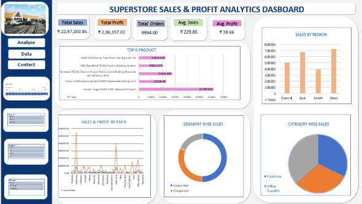

# Superstore Sales & Profit Analytics Dashboard | Microsoft Excel

An interactive Excel dashboard that analyzes sales performance, profitability, regional trends and product performance for a US retail business (2014–2017).

## Business Objective
Help management understand where the business makes money, where it loses money, and which pricing decisions affect profit.

## Dataset
- Source: Sample Superstore dataset
- 9,994 sales records, 2014–2017
- Fields: Order Date, Segment, Region, State, Category, Sub-Category, Product Name, Sales, Quantity, Discount, Profit

## What I Built
- Cleaned and structured the dataset for analysis
- 7 PivotTables analyzing sales and profit by region, category, segment, state, product and month
- KPI cards: Total Sales, Total Profit, Total Orders
- 5 interactive PivotCharts
- Slicers (Segment, Category, Region) and a Timeline for dynamic filtering

## Key Insights
| Metric | Result |
|---|---|
| Total Sales | $2.30M |
| Total Profit | $286K |
| Profit Margin | 12.5% |

- **Technology** is the top category by both sales ($836K) and profit ($145K).
- **Furniture** earns only a **~2.5% profit margin** despite $742K in sales.
- Orders with **discounts above 20% lose money overall (about -$135K)**, while undiscounted orders earn about $321K profit.
- **West** is the best region by sales and profit; **South** has the lowest sales.
- **California** and **New York** are the top states by sales.
- Sales grew each year from 2015 to 2017, reaching $733K in 2017.

## Recommendations
1. Cap discounts at 20% to stop loss-making sales.
2. Review Furniture pricing and discount policy.
3. Invest in the West and East regions, which perform best.

## Tools Used
Microsoft Excel | PivotTables | PivotCharts | Slicers | Timeline | Data Analysis | KPI Analysis

## How to Use
1. Download `Superstore_sales & profit_ Analysis dashboard.xlsx`
2. Open the **Dashboard** sheet
3. Use the slicers to filter by Segment, Category and Region

## Author
Mahalakshmi S | 
LinkedIn - https://www.linkedin.com/in/mahalakshmi-s-454497281/
Email id - mowriyaathl@gmail.com